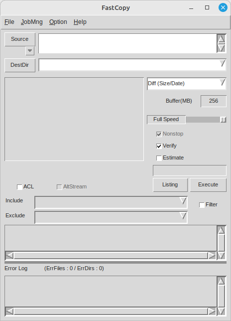
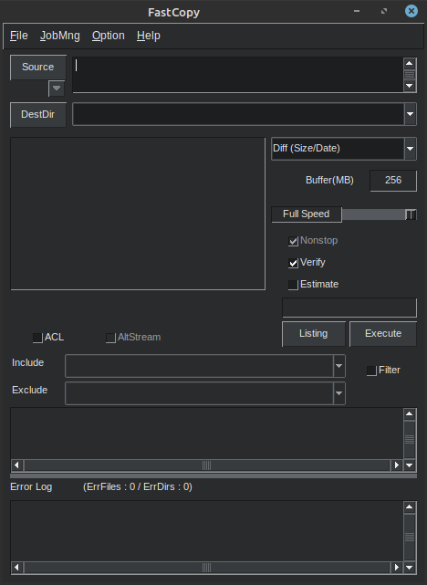
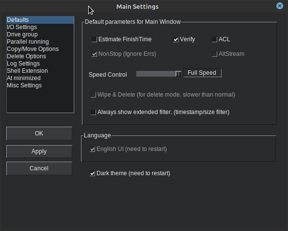

# FastCopy Linux CLONE

**A Linux-native reimplementation of the main file-transfer modes of FastCopy 3.63. This is an independent GPLv3 project, not an official FastCopy release.**

&nbsp;&nbsp;<br>
<p align="center">
  
</p>

## Install on Linux Mint Cinnamon or MATE

### Stable main menu (+menu1)

- File, JobMng, Option and Help now use a fixed-height, in-window menu bar instead of the X11 native Tk menubar. Moving the pointer across a closed menu bar changes only its highlight. When a dropdown is open, hovering over a different heading switches once; movement within the same heading does not repost it.
- Existing menu commands, nested menus, job management, check/radio items, F10, Alt mnemonics and arrow/Escape navigation are retained. The saved window geometry remains in the previous client-area format, so existing window sizes are preserved. The GUI supports both light and dark themes without new runtime dependencies.
- Mouse/keyboard regression tests passed in Xvfb/Openbox. The reported flicker on an actual Mint desktop could not be directly reproduced or verified here.

### Keyboard navigation in folder pickers (+typeahead1)

- Source, Add Directory and DestDir open with keyboard focus in the folder list. Type the first letter to select and scroll to a matching folder; type further characters within one second for case-insensitive prefix matching. Repeating the initial letter cycles through matching folders. A pause starts a new search. The search stays within the currently displayed directory.
- Enter navigates into the selected folder; Open accepts it. The Folder field still supports direct path editing when focused. Arrow keys, Ctrl-click and Shift-click selection, Home/Up/Go, and New Folder retain their behavior. The existing folder-only restriction is unchanged; individual files can still be entered directly into Source.
- No new dependencies or engine changes. Includes a dedicated keyboard-event regression test in `tests/test_typeahead_gui.py`.

### Cinnamon/MATE tray correction (+tray2)

- The application launcher, window title, icon name and tray tooltip are **FastCopy**. The desktop entry ID, icon resource filename, package name and saved-settings location are retained for upgrade compatibility. `fastcopy` remains the only GUI command.
- Detect minimization using the X11 window manager's ICCCM `WM_STATE` and EWMH `_NET_WM_STATE_HIDDEN` properties as well as Tk's state. This covers compositing window managers that leave a minimized client mapped. Ignore shading, workspace switching and Show Desktop. Once an accessible tray icon is registered, withdraw the main window so it is removed from the running taskbar list. A separately pinned launcher can remain on the panel. Clicking the tray icon restores the window; transfers continue while hidden.
- Prefer XApp status icons. If registration fails or times out, explicitly retry with a direct GTK status icon. If neither tray is available, normal minimization remains as a safety fallback; losing the tray while hidden restores the window. Cinnamon needs an enabled XApp Status Applet or System Tray; MATE needs an enabled XApp Status Applet or Notification Area.
- Tested on Xvfb/Openbox with an actual GTK/XEmbed tray host and simulated compositor-style hidden state. Native XApp and actual Mint Cinnamon/MATE sessions have not been runtime-tested. The source installer now selects the same package version as the build script.

### Listing correction (+listing1)

- Listing now shows all planned copies, directory creations and removals without the former 2,000-line truncation. Skipped files are summarized rather than individually displayed in the preview; the optional LastFileLog.log retains every engine record. Execute and Error Log also retain their complete output for the current job. Live output is appended in batches and does not force scrolling when the user has scrolled away from the end.
- This is a GUI-only correction for all six supported transfer modes. The static CLI engine, comparison rules, verification, deletion safeguards, paths, tray and launcher are unchanged. Size/Date modes still compare size and modification time, not file content if both attributes are identical.

### 0.2.8 — Folder-picker layout corrections

- Source displays **Multiple folders can be selected with CTRL-key** immediately below **Folders only**. The footer uses separate grid columns for the notes and action buttons, with a minimum width calculated from their requested sizes. Both Source and Add Directory use this layout.
- In the destination-only picker, **New Folder** is now in the top navigation row, between Home and Up (Go, Home, New Folder, Up). The footer contains only the Folders only note and Open/Cancel. DestDir remains single-selection.
- No changes to transfer semantics, folder creation behavior, themes or other dialogs. The original resource files are unchanged.

### 0.2.7 — Destination creation, resizable listing and trailing slash

- The destination-only folder picker introduced **New Folder** (moved into the header in 0.2.8). It asks for a single folder name, creates that folder in the currently displayed directory, and selects it. Open returns the path. Invalid names, existing entries and permissions errors are reported without overwriting anything. Canceling the name prompt creates nothing; canceling the picker after a successful creation does not delete the new folder. Both themes remain supported.
- Drag the horizontal divider between the file listing and Error Log up/down; the panes exchange height while the upper controls and the window's bottom margin stay fixed. Both panes have a minimum height. The divider remembers its last position; Up/Down work when it has keyboard focus.
- **Destination path behavior changes in this release.** A trailing `/` permits creating the destination directory (and missing parents) during Execute, and copies ordinary source directories by name. Without `/`, the destination must already exist, and a single directory's contents are copied directly into it. Multiple source directories keep their names. A trailing `/` on a source still explicitly selects its contents. Sync always mirrors the contents of one source into the exact destination (its deletion scope is unchanged); Move retains a source root when copying only its contents. A nonexistent destination without `/` is rejected, not silently redirected. Listing previews planned operations without creating directories. If Include matches no entries, no destination is created.
- Review saved jobs and CLI scripts created with older releases: they now use this destination convention. To preserve an old single-source folder-name copy, append `/` to DestDir; to copy contents, append `/` to Source. Do not use Sync/Move without checking Listing. Other dialogs, layout coordinates and original resource files remain unchanged.

### 0.2.6 — Multiple source folders and Home navigation

- Source supports multiple selections within the displayed directory. Click a folder, hold Ctrl and click additional folders, then press Open. Ctrl-click again deselects; Shift-click selects a range. Every selected absolute path is added to Source on its own line, using the existing path escaping rules. The Source context menu's Add Directory action appends all selected paths. Cancel leaves the previous selection unchanged.
- The Folder field shows the selected path for one folder or their common parent for multiple folders. Typing a different path selects that directory instead. Go, Up and Home navigate and clear selections; Home goes to the current user's home directory. Double-click navigates into the clicked folder. DestDir stays single-selection, with the same Home button. The Ctrl-key instruction appears immediately below Folders only in Source. Both themes are supported.
- No other GUI layout or transfer behavior changes (apart from version banners). The single-source Sync restriction remains.

### 0.2.5 — Folder picker, speed control and GUI corrections

- Source and DestDir buttons open the same palette-aware, folder-only browser. Click a folder and press Open to return its absolute path; double-click or Go to navigate, Up to move to the parent. No file type selector or file entries. Cancel preserves the existing value. Selected folders must exist; type a new destination directly in the main window if needed. Folder selection resolves symbolic links to real directories. Files can still be entered directly or imported via Nemo/Caja.
- Filter enables both Include and Exclude. Use semicolon-separated case-sensitive POSIX glob patterns, e.g. `*.txt;*.pdf`. Exclude takes precedence and can skip directories. Include matches file/link names or relative paths; traversal retains only directories containing matching entries. If nothing matches, no destination is created. Sync and Move reject both filters (including previews) to prevent unsafe deletion. Extended date/size filters remain unsupported.
- Both speed controls offer Suspend, 10% through 90%, and Full Speed. Main Settings saves the default; the main slider adjusts live transfers. The Linux engine adds delays based on the measured active I/O/hash time, rather than enforcing a fixed MiB/s or guaranteeing the exact percentage of peak throughput. The existing pause button resumes the previous nonzero level. Settings changes take effect with OK/Apply. `--speed-percent N` selects a CLI level; GUI uses the private `--live-speed` stdin control pipe. A disconnected control pipe cancels safely. Existing CLI SIGUSR1/SIGUSR2 and SIGINT/SIGTERM remain supported.
- The About icon is scaled to fit its original rectangle. CRLF resource text is normalized, and settings labels are fitted to their existing control rectangles. The repeated question-mark help buttons and Windows-only Play image button are omitted from Main Settings. Main Help menu and Filter help remain available. All original RC files, dialog layout coordinates, and previous slider/margin/theme fixes are retained.

### Launcher update (+launcher1)

Run `fastcopy` from a terminal to open the GUI. The application menu and Nemo/Caja integration use the new command. The old `fastcopy-mint` GUI command has been removed; `fastcopy` is the sole GUI launcher. Upgrading the Debian package removes the old compatibility symlink automatically. The Debian package name, `fastcopy-mint-cli` engine, integration helper, resources and saved settings are unchanged.

### Minimize to tray (+tray1)

Minimizing the main window moves FastCopy to the panel notification area. Click the FastCopy icon to restore the window. Copy/list operations continue while hidden, and the window close button retains its existing behavior. The helper prefers the native XApp Status Icon API (Cinnamon/MATE), with GtkStatusIcon/XEmbed fallback for traditional X11 system trays. GTK 3 is installed by APT; libxapp1 is recommended. If there is no supported panel applet, ordinary taskbar minimization remains available. Removing the applet or losing the helper while hidden restores the window automatically. The default Cinnamon System Tray/XApp Status Applet and MATE Notification Area/XApp Status Applet are supported by design; actual Mint sessions have not been tested here. Experimental Wayland sessions need a functioning XApp monitor and have not been tested.

The tray regression uses an isolated X11 display and a real window manager. With `libx11-dev`, `libxtst6`, `xvfb`, `openbox` and GTK 3 installed, compile `cc tests/tray_host.c -o /tmp/fastcopy-tray-host -lX11`, then run `xvfb-run -a sh -c 'openbox & sleep 1; python3 tests/test_tray_gui.py linux/gui.py /tmp/fastcopy-tray-host build/fastcopy-mint-cli'` (use the actual engine path). The test requires an X11 tray fallback backend; on Mint, a native XApp monitor is not required for the test.

### Static-engine compatibility package 0.2.8+static1+launcher1+tray1

Install with `sudo apt install ./fastcopy-mint_0.2.8+static1+launcher1+tray1+command1+listing1+tray2+typeahead1+menu1_amd64.deb`. The CLI links glibc, libstdc++ and libgcc into its executable; its ELF headers contain no dynamic interpreter or shared-library dependencies. The GUI uses the host Python 3 and Tk packages plus GTK 3 for the tray helper. This eliminates the reported Mint 21.x glibc/libstdc++ ABI dependency mismatch. Mint 21.x and 22.x AMD64 compatibility is expected, not verified on a real Mint desktop. The static runtime must be rebuilt for library security updates. See `STATIC-BUILD.md` for the source/relink notices.

To build this variant locally: `FASTCOPY_STATIC=1 ./build-deb.sh` (after installing the build prerequisites below). To install from source in static mode: `FASTCOPY_STATIC=1 ./install.sh`. A regular local dynamic build remains preferable for routine system-library security updates. See `STATIC-BUILD.md` for the static library versions, source and relinking notes.


Target: Linux Mint 21.x (Ubuntu 22.04/Jammy), 22.x (Ubuntu 24.04/Noble) and compatible Debian/Ubuntu desktops. Linux Mint Debian Edition should also build with the listed dependencies. The project is built on the actual target machine to avoid newer glibc or libstdc++ dependencies from the development machine. No Wine, Qt, OpenSSL 1.0 or Internet downloads of old binaries are required. APT needs its normal package repositories. Run as your regular desktop user, not root:

```sh
./install.sh
```

This installs build dependencies, builds and tests the C++ application, generates an architecture-specific Debian package in `dist/`, installs it via APT, and registers user-level Nemo and Caja scripts. To build without installing: `sudo apt install build-essential cmake dpkg-dev python3 python3-tk libglib2.0-bin`, then `./build-deb.sh`. To remove the program and right-click scripts:

```sh
fastcopy-mint-integrate --remove
sudo apt remove fastcopy-mint
```

Saved jobs remain under `$XDG_CONFIG_HOME/fastcopy-mint` (default `~/.config/fastcopy-mint`). The generated `.deb` is for the build distribution and architecture, not a universal binary. The supplied AMD64 package is the static-engine build; install it on Mint 21.x or 22.x with APT, then run `fastcopy-mint-integrate` as your regular user if desired. The local source build is the most reliable option. Do not upgrade glibc manually to install the package. Install the GUI and CLI via the package; `fastcopy` opens the GUI; `fastcopy-mint-cli --help` shows the CLI. In Nemo or Caja, select local files/folders, right-click, choose **Scripts > Open in FastCopy Mint**. This only loads the selection; it never executes a transfer automatically. If the Scripts submenu does not appear immediately, reopen the file manager window. The main interface uses Tk/ttk; the tray helper uses GTK 3/XApp. It runs in a normal X11 or XWayland session.

## Original GUI clone (0.2.x)

### 0.2.4 Dark theme checkbox

Open **Option > Main Settings > Defaults**. Below Language, check **Dark theme (need to restart)** for dark mode or uncheck it for light mode. Apply or OK saves the preference; Cancel discards unapplied changes. Close and reopen FastCopy Mint to load the new palette. The checkbox initially reflects the detected desktop theme on installations with no saved preference. Opening the dialog and applying unrelated settings does not turn off automatic detection. Changing the checkbox explicitly saves `theme: "dark"` or `theme: "light"` in `settings.json`. Launch-time `FASTCOPY_MINT_THEME=dark`, `light`, or `auto` takes precedence for that launch. To restore automatic detection permanently, close FastCopy Mint and set `"theme": "auto"` in `~/.config/fastcopy-mint/settings.json` (or the equivalent XDG configuration path). The original RC and existing control positions are unchanged.

### 0.2.3 light/dark theme and target-system installer

The GUI automatically selects a light or dark palette at startup based on Cinnamon or MATE GTK theme settings (including common Mint-Y-Dark and Mint-X theme names), GSettings color scheme and GTK configuration. The original resource layout, icons, controls and transfer behavior are preserved. This is a Tk palette adaptation, not a native GTK theme renderer. Window decorations follow the window manager; restart FastCopy Mint after changing your desktop theme. Override automatic detection for one launch with:

```sh
FASTCOPY_MINT_THEME=dark fastcopy
FASTCOPY_MINT_THEME=light fastcopy
```

The installer removes an incomplete installation of FastCopy Mint if necessary, builds in a clean temporary build directory and calculates package dependencies against the target system. Dynamic builds made on Debian 13 require newer libraries than Mint 21.x. The separate static-engine package addresses that issue; local `./install.sh` is also supported. The locally built Mint 21.x AMD64 package is expected to be usable on newer compatible Mint systems; that cross-release compatibility has not been tested.

### 0.2.2 main-window margin corrections

The main dialog now has an equal outer inset of four dialog units (8 pixels at the current scale) on both sides. Source and destination editors, mode selector, buffer field, speed slider, disk indicator, Execute, extended MaxSize field and full-width log editors share the right edge. The Listing/Execute pair and buffer label/value pair retain their widths and internal spacing; filter controls are right-aligned. The speed slider remains vertically centered, and its width is shortened to prevent clipping at the right edge. The margin remains equal after enlarging or shrinking the main dialog. No other dialogs, upstream resources or transfer logic were changed (apart from the version banner).

### 0.2.1 GUI corrections

The main-window speed slider and the Defaults-page speed slider are vertically centered with their neighboring labels. The Windows Task Scheduler button and its explanatory note are omitted from the Job dialog. The original resource definitions, other baseline control positions, dialog sizes and transfer behavior are unchanged. Resize positioning now follows the actual content-frame dimensions so controls do not retain stale coordinates after shrinking the window.

This revision replaces the redesigned 0.1.0 interface with a resource-driven recreation of the original English FastCopy 3.63 interface. `linux/generate_layout.py` parses the English section of the unmodified `src/fastcopy.rc`; its checked-in `rc_layout.json` contains all 20 application dialog templates, 229 original control definitions (217 total controls rendered on Linux, including the added theme checkbox) and the complete File / JobMng / Option / Help menu tree. The main window retains original control IDs, relative positions, captions and original icon artwork; Main Settings contains all ten original settings pages. The default view collapses timestamp/size fields as upstream does. Enable Option > Show Extended Filter to see them. Tk widgets emulate Win32 controls at 2 pixels per dialog unit, using Liberation Sans and Liberation Mono; Linux window decorations, font metrics, scrollbar styling and file/directory pickers differ. This is not a pixel-identical Win32 rendering or a port of every callback.

- Source and DestDir, history, the original copy-mode labels, Listing, Execute, Verify, Estimate, job registration/deletion, the copy-confirmation dialog, About, configurable buffer budget, HDD-mode worker selection, logs and selected settings are connected to the native engine. Right-click Source to select or append files/directories. One path per line; paths containing a literal newline are shown as JSON strings.
- **Unsupported controls remain visible but disabled, except the removed Windows Task Scheduler shortcut and note, and settings Play/help buttons.** Include and Exclude glob patterns are implemented; extended date/size filters remain disabled. Delete all appears in the mode list but cannot execute. Post-Process, Wipe & Delete, Windows-specific tray settings and most Win32-specific settings are not operational. The original Error Occured, New Directory and Delete All Files/Dirs templates are included and rendered in tests, but their original workflow is not wired into the engine. Source and destination browsing uses the themed folder-only Tk browser, not the Windows Shell browser. Japanese resources are preserved in the original RC but not rendered by this version.
- Nonstop is fixed on: the engine reports errors and continues eligible entries; destructive cleanup is skipped after errors. The speed trackbars support 0 through 100% in 10% increments; intermediate levels throttle active I/O/hash work. ACL enables Linux POSIX ACL and user xattr copying; AltStream is disabled (no NTFS alternate-stream support). The original 256 MB Buffer field represents a total worker-buffer budget, capped at 64 MiB per worker; not the original Win32 asynchronous I/O buffer. Verify defaults on and is mandatory for move. Status fields show available engine counters, not invented read/verify counters. No exact performance or behavioral equivalence is asserted.
- Sync and Move retain the original copy-confirmation layout with an explicit deletion warning and Cancel focus. The engine and its prior safeguards remain unchanged except the version banner. Use Listing before destructive operations.
- All resource-derived templates have been rendered under Xvfb and the packaged GUI has been exercised. Actual Linux Mint Cinnamon and MATE sessions and pixel-by-pixel comparisons against a running Windows FastCopy have not been performed.

Regenerate the layout after editing resources: `python3 linux/generate_layout.py`. The upstream `.rc` is intentionally unchanged.

## Transfer modes

| Mode | Behavior |
| --- | --- |
| `diff` | Copy missing files or files with a different size or nanosecond modification timestamp; compare symlink targets. |
| `no-overwrite` | Never replace existing files; conflicting file types are rejected. |
| `newer` | Copy missing files or files whose source modification timestamp is newer. |
| `overwrite` | Replace every selected file. |
| `sync` | Mirror the contents of one source directory into the destination; remove destination-only entries. Requires explicit `--allow-delete` or a non-destructive preview. No include or exclude patterns. |
| `move` | Copy and verify all selected files; only then remove source files and empty source directories. Requires verification and explicit `--allow-delete` or preview. No include or exclude patterns. |

Examples (a trailing slash on the destination permits creation; a trailing slash on a source directory explicitly selects its contents):

```sh
fastcopy-mint-cli --mode diff --workers 4 --dest /media/user/Backup/ -- /home/user/Documents/
fastcopy-mint-cli --mode sync --dry-run --dest /media/user/Backup/Documents/ -- /home/user/Documents/
fastcopy-mint-cli --mode sync --allow-delete --dest /media/user/Backup/Documents/ -- /home/user/Documents/
fastcopy-mint-cli --mode overwrite --no-verify --exclude '*.tmp' --dest /path/to/destination/ -- /path/to/source/
```

In the GUI, use Listing to inspect the planned actions before Execute. Sync removes extras **from the destination**; Move removes files **from the source**. Do not run them against irreplaceable data without a separate backup and a reviewed preview. There is no undo or transaction across an entire job. Cancellation retains already committed files; if deletion has begun, already deleted entries cannot be restored by this tool. `SIGUSR1` pauses, `SIGUSR2` resumes, and `SIGINT`/`SIGTERM` cancels the CLI. Cancellation may wait on an active filesystem operation. Exit codes: 0 success, 1 error, 130 cancellation.

## Architecture and upstream provenance

- `src/`, `doc/`, `help/`, `external/`, and Visual Studio files are retained unmodified from the supplied FastCopy 3.63 tree. The upstream Windows application is not compiled on Linux.
- `external/xxhash/xxhash.c` and `.h` (version 0.6.5, BSD 2-Clause) are compiled into the new native C++17 engine. The upstream mode names and semantics documented in `help/fastcopy_eng.htm` informed the implementation.
- `linux/engine.cpp`: POSIX file descriptors, filesystem traversal, per-file temporary output and atomic rename, buffered sparse-aware copying, per-file read-back xxHash64, configurable independent transfer workers, file/directory metadata and error checks. Auto workers uses 1 for same `st_dev`, 4 when any source device differs; this is a simple heuristic, not FastCopy's original disk scheduling algorithm. Buffer default 4 MiB per worker.
- `linux/gui.py`: Tk resource-layout clone, job profiles, listing, progress, logs, pause/resume and cancel. `packaging/`: application menu and Nemo/Caja integration.

## Safety and known limitations

- Preview release, not a full port of FastCopy 3.63. No Windows Explorer integration, NTFS alternate streams, VSS, secure wipe or standalone delete mode, original overlapped Win32 I/O engine, original disk-cache bypass, MD5/SHA algorithms, or benchmarked FastCopy-equivalent throughput. No native drag-and-drop, clipboard replacement, or native GTK widget rendering. Light/dark palette detection is supported. No direct `smb://` / SFTP URI support; use mounted filesystem paths.
- Default verification rereads each newly written file and compares xxHash64 with the bytes read from its source. It is a fast non-cryptographic checksum, not a security hash; it is not an independent raw-disk read. Skipped files are not hashed. Diff compares size and timestamp, so equal size/time does not guarantee identical contents. Timestamp precision differs across filesystems (e.g. FAT); repeat copying may occur. No resume of partial files after cancellation.
- Symlinks are copied as links, not followed during directory traversal; symbolic-link parents within the destination tree, path overlaps, same-inode file copies and special files (FIFO, device, socket) are rejected. Permissions and timestamps are preserved by default (ownership and setuid/setgid bits are not). Existing directory metadata is not updated in Sync or No-overwrite. Hard links are copied independently (not preserved as a shared inode). Sparse all-zero buffers are represented as holes. Optional user xattrs and POSIX ACLs are copied for regular files and directories; no security namespaces or symlink xattrs. Some filesystems cannot store this metadata; disable preservation/xattrs for such destinations. Symlinks require filesystem support.
- Same-directory temporary files are flushed before replacing destination files. Explicitly selected overwrite/diff modes can replace existing content. Errors prevent entry into source removal / destination pruning; an error or cancellation during a deletion phase can leave a partial move or sync. Directory fsync and file changes are checked on move. The program detects common concurrent source/destination changes, but pathname-based operations are not hardened against adversarial concurrent renaming, mount changes or bind-mount aliases. Do not use it with untrusted concurrent writers or as root. Sync rejects filesystem root, the home directory itself and common system directory roots, and refuses pruning across a different device; it is not a sandbox. Never select a broad destination such as a disk containing unrelated files.
- Full source tree is scanned before transfer; memory and log usage grow with file count. Per-file fsync and verification can reduce throughput for many small files. No performance benchmark on your drives has been performed.
- Build/test environment: Debian 13, GCC 14.2, Python 3.13, Tk 8.6. Actual Mint 21/22 Cinnamon and MATE sessions, SMB/NFS, removable filesystems and physical-disk performance have not been tested in this environment. The design uses libraries available on both editions, but desktop compatibility requires validation on the target machine. See `TEST-RESULTS.txt` for tests actually run.

## Developer build

```sh
cmake -S . -B build -DCMAKE_BUILD_TYPE=Release
cmake --build build --parallel
ctest --test-dir build --output-on-failure
python3 linux/gui.py
```

## Licensing

The retained FastCopy 3.63 code is copyright (C) 2004–2019 SHIROUZU Hiroaki and (C) 2018–2019 FastCopy Lab, LLC, GPLv3. The new Linux-specific code in this package is distributed under GPL-3.0-only, with upstream license text in `doc/license-gpl3.txt`. xxHash retains its BSD license in `external/xxhash/LICENSE` and `doc/xxhash-LICENSE.txt`. The original zlib source and its license notices are retained but not used by the Linux build. All source necessary to build the application is included; system build/runtime dependencies are separate.
